🇮🇹 Progetto architetture di automazione con **Ansible** e lavoro ogni giorno su **sicurezza informatica** e sistemi **Linux/Unix**. Oggi sono in **Accenture**, dove mi occupo di architettura Ansible e architettura IT, oltre che di risoluzione delle vulnerabilità; in precedenza sono stato Automation Architect in **Lutech**. Sto costruendo **[DoubleL](https://official.doppiaelletech.workers.dev/)** insieme a [@lorenzocarovillano](https://github.com/lorenzocarovillano).

🇬🇧 I design automation architectures with **Ansible** and work daily on **cybersecurity** and **Linux/Unix** systems. I'm currently at **Accenture**, working on Ansible and IT architecture as well as vulnerability remediation; previously I was an Automation Architect at **Lutech**. I'm co-building **[DoubleL](https://official.doppiaelletech.workers.dev/)** with [@lorenzocarovillano](https://github.com/lorenzocarovillano).

---

### 🚀 Live products

- **[Brief2Done](https://brief2done.doppiaelletech.workers.dev/)**: a workspace for finding projects, agreeing on terms and managing delivery. [Product page ↗](https://doppiaelle.github.io/marketing-advertising/brief2done/)
- **[feeddy](https://feeddy-dev.duckdns.org/)**: content planning, social media workflows and AI-assisted tools. [Product page ↗](https://doppiaelle.github.io/marketing-advertising/feeddy/)
- **[GitGram](https://gitgram.doppiaelletech.workers.dev/)**: GitHub-connected collaboration, real-time chat and project activity.

### 🛠️ In development

- **[LL Platform](https://doppiaelle.github.io/marketing-advertising/ll-platform/)**: multi-tenant infrastructure orchestration built around Kubernetes, AWX and Ansible.
- **[SecuRA](https://doppiaelle.github.io/marketing-advertising/secura/)**: self-hosted vulnerability management and remediation tracking.
- **[Kritoma](https://doppiaelle.github.io/marketing-advertising/kritoma/)**: an independent trading card game, with digital card design tools and an online play system.

### ⚙️ Tech

**Automation:** Ansible, AWX, Event-Driven Ansible, GitLab CI/CD
**Systems:** Linux (RHEL), Unix (AIX, Solaris, HP-UX), Bash, Python
**Security:** vulnerability remediation, system hardening, penetration testing (CompTIA PenTest+)
**Infrastructure:** Podman, Docker, Kubernetes, OpenShift, Zabbix, Grafana

---

[**DoubleL ↗**](https://official.doppiaelletech.workers.dev/) · [**GitHub organization ↗**](https://github.com/doppiaelle)
